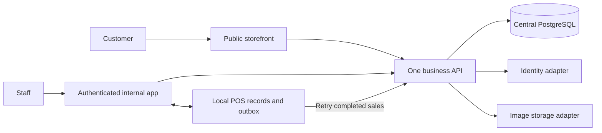

# BRAVOS implementation blueprint

Updated: 2026-09-08. **Accepted through the reviewed v1 specification and the user's instruction to proceed.** Historical proposed/accepted labels below record review provenance; the approved [v1 specification](bravos-v1-spec.md) takes precedence. See [implementation progress](implementation-progress.md) for actual delivery and verification status.

All 63 numbered business questions are answered. [Discovery D01-D51](discovery.md) records those answers; [bravos.md](../../bravos.md) remains the baseline where later answers do not change it. This document consolidates the implementation proposal, rather than opening another numbered interview.

**Accepted** means already agreed by the user. **Proposed** means a concrete implementation or operational extension presented here for review. Approval of this draft would allow local implementation and verification, with domain/hosting booking remaining after website completion. Launch values can be supplied together later.

## 1. Business agreement

| Area | Accepted behavior |
| --- | --- |
| Inventory | One central inventory for both branches and online orders. Quantities belong to size/color variants. No branch balances or transfers. |
| Physical sales | Cash, with branch/employee attribution; final once goods are received and payment collected, including offline. Never knowingly accept three against a known quantity of two. |
| Online orders | Guest COD request holds no stock. Representative checks and physically sets aside items before WhatsApp confirmation. Confirmation deducts availability once; shipment/delivery do not deduct again. |
| Failed/cancelled orders | Pending cancellation adds no stock. Pre-shipment cancellation releases its allocation once. A failed parcel remains unavailable until physically received and inspected; restore only sellable quantities. |
| Batches | Separate old/new purchase costs. Allocate oldest available batch first (FIFO); restore sellable returns to their original allocated batches. Staff see total quantities and selling prices, not costs. |
| Discounts/refunds | Employees choose the POS deduction without a manager cap; reason optional, zero total allowed. In the 300/200 basket with 50 off, paid values are 275/175. The manager can edit the final refund; 850 paid suggests 850 refunded. |
| Returns | Dedicated manager-operated section with original-transaction picker and linked details. Either branch, partial unreturned quantities, inspection, cash Owed/Paid, 14 days from receipt. Later defect cases are handled externally through WhatsApp. |
| Expenses/access | Employees and managers add expenses; employees see their own authorized-branch records. Manager sees all records/costs/profit and makes linked corrections. Personal staff accounts and assigned branches. |
| Website | Arabic, product photos/search/details, variants, cart, guest checkout, promotions, WhatsApp/social links. Out-of-stock products remain browsable with the label on the product page; unavailable variants cannot be ordered. |
| Reports | Completed physical sales and Delivered online orders; final order values, daily/calendar-month/branch reports, purchases, expenses, best sellers, low stock, inventory value and merchandise profit. PDF/Excel exports. No tax or courier accounting. |
| Release | Separate public and authenticated internal URLs. Data-only protected backups; images optional outside the required backup. Local development first; book domain/hosting after website completion. |

The [Returns specification](returns.md), [architecture principles](../architecture/principles.md), and [glossary](../../CONTEXT.md) retain the detailed agreed policies. The brief's other accepted scope remains; this table is a guide rather than a replacement.

## 2. Proposed stack and application boundaries

**Recommendation:** a TypeScript monorepo with two frontends and one modular business API backed by PostgreSQL. Relational constraints and transactions fit shared stock, retained cost batches, linked returns/corrections, and reporting. This is an architectural assessment, not a claim that alternative platforms cannot do those operations; the [options comparison](../architecture/options.md) includes Appwrite's current transaction support.

| Part | Proposal and purpose |
| --- | --- |
| Workspace | TypeScript and pnpm workspaces, explicit package dependencies, one lockfile and reproducible checks. |
| Public store | Next.js for rendered product pages, metadata, catalog/cart and guest checkout. No internal screens or privileged modules in its build. |
| Internal app | React with Vite, an installable PWA with explicit essential-POS caching. Dashboard, POS, Orders, Returns, Expenses and management share this authenticated app. |
| Business API | Fastify as the HTTP adapter around framework-independent use cases. One deployable API initially, with feature ownership inside it. |
| Central data | PostgreSQL, the `pg` driver and versioned SQL migrations. Server transaction adapters own stock/concurrency control; browsers cannot write database tables directly. |
| Local POS data | Dexie over IndexedDB for safe product/pricing snapshots, carts, completed cash sales and a durable synchronization outbox. Network synchronization is BRAVOS application logic. |
| Identity | Better Auth with PostgreSQL, username and admin plugins behind an identity adapter, subject to the provisioning proof below. |
| Product images | File-storage interface: local storage in development, a suitable persistent/object-storage adapter when hosting is selected. Product records retain image references. |

Official documentation supports [Next.js rendering](https://nextjs.org/docs/app/getting-started/server-and-client-components) and [self-hosting](https://nextjs.org/docs/app/guides/self-hosting), [Vite builds](https://vite.dev/guide/), [Fastify auth integration](https://better-auth.com/docs/integrations/fastify), [pnpm workspaces](https://pnpm.io/workspaces), [PostgreSQL driver transactions](https://node-postgres.com/features/transactions), and [Dexie transactions](https://dexie.org/docs/Dexie/Dexie.transaction()). These capabilities do not by themselves implement the required business behavior.

Use separate local origins during development and separate public/internal hosts in production. Route each frontend's API requests through its own same-origin gateway to the shared API; authenticate internal requests with secure cookies and explicit origin/CSRF protections. The public gateway exposes only public operations. Verify this topology with the auth adapter before building staff workflows. Domains and providers are not chosen by these placeholders.

Local inspection found Node 22.13.1 and pnpm 11.19.0 runnable; `docker`, `psql`, and `postgres` were not on PATH. This does not prove PostgreSQL is absent, but a running local database has not been verified. Before installing dependencies, select maintained compatible runtime/package versions and verify the local database route. The existing Node version meeting framework minimums is not a production security/update check.

## 3. Proposed feature ownership and imports

Use `apps/storefront`, `apps/internal`, and `apps/api`. Put business capabilities in feature packages with `domain`, `application`, and `adapters` where those responsibilities exist. Keep frontend views close to their feature in the relevant app; do not introduce empty layers merely to match a template.

| Feature | Owns |
| --- | --- |
| Catalog | Products, unique product codes, variants, categories, images, website status and size guides. |
| Pricing | Listed prices, offers, bundles, coupons, discount evaluation and immutable accepted price breakdowns. |
| Inventory | Central availability, cost batches, allocations, movements and discrepancy resolution. All stock-changing workflows call its public operations. |
| Receiving | Purchase receipt records and linked corrections; coordinates inventory batch creation/adjustment. |
| Physical sales | Completed cash sales, staff/branch attribution and linked recording corrections. |
| Online orders | Guest requests, customer/delivery details, contact attempts and permitted order transitions. |
| Returns | Original-purchase lookup, received items, inspection, refunds and exchanges in a dedicated workflow. |
| Expenses | Branch expenses, creator visibility and linked manager corrections. |
| Identity/access | Staff accounts, role/branch grants, sessions and recovery. |
| Reporting/operations | Authorized read models, exports, aggregate analytics, opening import and backup/restore coordination. |

Domain/application code depends on its own rules and declared ports; adapters depend inward. Cross-feature use goes through explicit public entry points, never private files or another feature's tables. A transaction coordinator lets multiple feature operations share one PostgreSQL transaction; modular boundaries must not split an atomic confirmation into unrelated commits.

Use focused package exports and aliases. Share only genuinely common primitives such as money and identifiers, plus explicitly safe contracts. Keep private cost models and database/identity adapters server-only. Enforce import direction, public entry points and cycle freedom in CI from the foundation stage. Route-level splitting and lazy PDF/Excel export code reduce initial loads; cache the entire essential POS path before offline work. **Module Federation remains deferred.**

## 4. Proposed screens and access

The internal menu is permission-based: Dashboard, POS, My Sales, Orders, Returns, Products, Inventory/Receiving, Expenses, Reports, and Staff/Settings/Backup. Arabic labels and layouts follow the accepted simple, high-contrast direction; show the active branch and unsynchronized-sale count clearly. Purchase costs and profit are restricted at the API/data level, not merely hidden in the menu.

| Capability | Cashier | Assigned representative | Manager |
| --- | --- | --- | --- |
| Cash sales/manual discount | Own authorized branches | When also assigned cashier duties | Yes |
| Saved sales/expenses | Own authorized records | Own records; assigned order work | All |
| Add expense | Active authorized branch | Active authorized branch | Both branches |
| Confirm/manage online orders | No, unless assigned | Routine accepted transitions | All and corrections |
| Receiving, cost/profit, catalog/pricing changes | No | No | Yes, online |
| Returns/exchanges, saved-record corrections, staff/backup | No | No | Yes, online |

The public store has no dashboard/POS/Returns navigation. Customer checkout requires name, primary mobile, area and detailed address; alternate phone, landmark and notes remain optional. Use a simple submission reference and WhatsApp instructions, without adding a customer account or tracking portal.

## 5. Proposed money, refund and cost mechanics

### Discount allocation and editable refunds

Store EGP as integer piasters. Preserve the original unit prices, each promotion/coupon effect, employee deduction, allocated paid values and transaction total at acceptance. Historical purchases never reprice when the catalog changes.

**Accepted example:** 300 + 200 with 50 off means 25 off each, leaving **275 + 175 = 450**. A full return of an 850 payment suggests **850**. The manager can change the final refund amount.

**Proposed extension:** divide a basket-wide fixed deduction equally across eligible sold units, rather than display rows. Merge repeated identical variant lines before assigning stable unit positions so splitting a row cannot change the result. Cap a unit's allocated discount at its remaining price and redistribute the remainder equally to units that still have value. Allocate leftover piasters deterministically by stable variant/unit order. A discount cannot exceed the basket's remaining total.

Examples for review:

| Purchase after earlier offers | Proposed fixed-discount allocation |
| --- | --- |
| Two units at 300 each and one at 200; 60 off | 20 off each sold unit: 280, 280, 180. |
| Units at 10 and 100; 50 off | First unit can absorb only 10; the other absorbs 40: paid values 0 and 60. |
| Three eligible units; 1 EGP off | Shares 0.34, 0.33, 0.33 in the stable order; exactly 1 EGP in total. |

Item-specific offers attach to their affected units; percentage reductions follow the affected unit prices with exact-total rounding. For a fixed bundle, first calculate its saving against included unit prices, then use the equal/capped allocation above across those units. Basket fixed-amount coupons use the same rule across eligible units. These are proposed generalizations, not an assertion that Q62 specified every promotion algorithm.

Validate dates, eligibility and known coupon limits before completion. Proposed outage behavior uses the cached rules and locally known remaining uses; a global usage limit cannot be guaranteed across disconnected tills. Preserve a completed cash sale and its accepted price if reconnection reveals excess coupon use, recording the discrepancy for the manager. Connected confirmation still checks the central usage limit atomically. Do not silently charge the customer again or remove an accepted discount.

In Returns, show the suggested paid-value total and an editable **Refund amount**. Record suggestion, final authorized amount, manager/time and cash paid separately. No new refund cap or mandatory override reason is proposed; notes are optional. Nonnegative monetary validation and purchased/unreturned quantity limits still apply. Reports use the actual authorized refund, while Owed/Paid records track whether that money has changed hands.

Accepted exchange behavior uses the manager's final return value as credit against the replacement's current price after offers. Example: suggested 275, manager chooses 280, replacement costs 320: collect 40. If the replacement costs 200, owe/pay the customer 80 in cash. Retain linked return and replacement records without altering the original sale or creating a persistent store-credit balance.

Proposed settlement detail: distinguish credit applied to the replacement from actual cash Owed/Paid. The 280/320 exchange has 280 immediate credit and 40 cash collected, not an outstanding cash refund of 280. The 280/200 exchange applies 200 credit and records only the remaining 80 as a cash refund. Validate replacement quantities against actual available central stock, excluding protected allocations, and allocate FIFO; record sellable original-batch restoration separately without counting expected or unsellable returns as available.

Additional promotion proposals from the specification review: a manager may finally close an undelivered failed order as cancelled after receipt/inspection, releasing consumed coupon usage once; failure or receipt alone does not release usage, nor does a Delivered customer return under the proposed default. A returned free reward suggests its stored paid value, usually zero, without repricing retained items; the manager may still edit that refund. These remain proposals for the existing final review.

### FIFO and corrections

Order available batches by recorded receipt time, then a stable batch identifier for ties. Opening imports retain the true batch order/costs; never fabricate an average. Example: 10 units at cost 100 and 10 at cost 140; sell three for 200 each: remaining available inventory is 7 × 100 + 10 × 140 = 2,100, with 300 cost allocated to that sale. A sellable one-unit return restores its original cost-100 batch, producing 8 old and 10 new units.

Online confirmation allocates batches and removes availability in one operation. Delivered recognizes completion using those same cost allocations. Cancelling before shipment releases the original allocation once; failed delivery waits for receipt/inspection. An unsellable returned item does not become available or receive a sellable-stock value.

When one purchase spans multiple batches and physically identical returned units cannot be distinguished, propose restoring against the purchase's earliest remaining unreturned allocation. Never substitute a current/new cost. Receiving corrections retain original values; apply a linked quantity/cost correction to affected remaining units and a traceable cost adjustment for already allocated units. Show both original and effective corrected figures rather than silently rewriting sale history. A positive stock correction must identify its real batch/cost source; an unresolved cost is flagged, not invented.

Proposed cost-correction example: an original allocation at 100 explicitly corrected to 140 retains the original value and linked adjustment of 40. A later sellable return restores/reverses effective value 140 with both links, without leaving 40 charged to a fully returned unit. Receiving unrelated new stock at 140 alone never changes the old allocation.

## 6. Proposed durability, concurrency and offline recovery

The local completion transaction writes the cash sale, its lines and outbox command together before showing that the sale is saved. Keep network requests outside that IndexedDB transaction. Show completion separately from synchronization. Pre-cache essential POS code, request persistent browser storage where available, and never clear queued sales during logout, account switching or updates. Browser storage remains dependent on the device; the app cannot recover data physically erased before synchronization.

If local persistence fails, clearly report that recording failed and preserve the in-memory details for recovery; do not show a false saved receipt or pretend that already exchanged goods/cash were reversed. Production acceptance includes a local-storage failure path.

Retry in the foreground on reconnect/startup and provide a manual retry. Background Sync may help where supported, but closing a browser must not be presented as a guarantee of automatic delivery. Use an operation ID, device ID, actor/branch identity, original occurrence time and payload fingerprint. The API records receipt time separately. The same accepted ID/payload returns its original result; a reused ID with changed contents is rejected for review.

Return acknowledged operation IDs and a stock snapshot/version that states which operations it includes. Update local acknowledgements and stock together, then apply only local movements not included in that snapshot. A refreshed balance must not subtract an acknowledged sale again or briefly restore a locally sold unit to availability. Coordinate multiple tabs on one device so they cannot independently spend the same locally known stock.

One PostgreSQL transaction validates permissions, records the operation, locks relevant variant/batch rows in stable order, applies allocations/movements and stores the business result. Every statement uses the same checked-out database client. Retry transient conflicts without duplicating business effects. Two simultaneous online confirmations for one available unit can accept only one; known quantity limits apply to the entire basket.

**Proposed late-sale handling:** a completed offline cash sale is retained even when the central balance has changed. Allocate available FIFO units without taking a confirmed order's protected allocation. If there is insufficient stock/cost, keep the completed sale and an unresolved allocation remainder for manager review. Show the variant as unavailable while the shortage is unresolved, and identify affected profit as incomplete. Reconcile the remainder against the real missing movement/batch before releasing new availability. Do not silently drop the sale, invent a batch cost, or automatically rewrite earlier accepted allocations.

The requirement for known tills to synchronize and staff to pause stock-changing work briefly before finalizing a quantity correction is already accepted. Proposed mechanics record the count boundary and each device's acknowledgement. This is an operational pause, not a claim that the server can stop a disconnected cashier. A late movement is retained and reconciled against whether the physical count already included it, so it cannot be subtracted twice.

### Accounts and sessions

Better Auth supports username login and admin provisioning/reset, but account creation still requires an email-shaped field. Proposed adaptation: generate a private immutable identifier under the reserved `.invalid` domain; staff supply only their login name/password. Keep verification/mail flows disabled for these internal identifiers, disable public signup, and use library-managed password hashing/sessions. The owner has a separately configured recovery route with a real recovery contact. [Username plugin](https://better-auth.com/docs/plugins/username), [admin plugin](https://better-auth.com/docs/plugins/admin), [PostgreSQL adapter](https://better-auth.com/docs/adapters/postgresql), [reserved domains](https://www.iana.org/assignments/special-use-domain-names).

Prove manager provisioning with the username plugin, normalization/uniqueness, manager resets without staff email, owner recovery, cookies and public-signup rejection against pinned versions before accepting the adapter. Support Arabic display names; if Arabic login names are used, configure and test the documented username validator instead of relying on its ASCII default.

Propose continued local POS use by the previously authenticated staff identity during an outage, until explicit sign-out; it is not a fresh offline login. Revalidate the online session and grants when reconnecting. Revocation prevents new connected work, but never deletes previous completed sales. Normal valid-session queues upload automatically; expired/revoked identity queues remain preserved for reauthentication or manager-assisted recovery. Do not trust a client timestamp alone as proof that a revoked user had permission.

Account switching hides the previous account's local records while retaining its outbox. Keep privileged cost/profit views online-only initially, so manager reads do not seed a shared cashier cache. Cashier devices use the existing OS lock for unattended access. Updates migrate queues transactionally and defer activation if safe migration cannot be demonstrated.

## 7. Proposed order and Returns state details

Online states: Pending (قيد المراجعة), Confirmed (مؤكد), Shipped (تم الشحن), Delivered (تم التسليم), Cancelled (ملغي), and Delivery failed / Awaiting return (تعذر التسليم / بانتظار الرجوع). Pending and pre-shipment Confirmed orders may cancel through the accepted representative workflow; shipped failures require the receipt/inspection path. No ordinary transition skips confirmation or repeats its stock deduction. Manager corrections retain the original transition history.

Pending requests preserve what the customer requested. Before confirmation, the representative records agreed item/quantity/price changes after WhatsApp contact and confirms only that revised, valid basket. Later catalog changes cannot silently alter confirmed prices. Customer-unreachable cancellation remains manual after configurable 48 hours and at least two recorded attempts; confirmed orders do not automatically expire. Do not add automated customer messages.

Returns has its own list, original-transaction picker and details. Propose an editable draft with no stock/refund effects, followed by a posted received/inspected return with cash Owed/Paid tracked separately. The same received units cannot be returned twice. Optional notes describe condition or an unusual amount without making an ordinary explanation mandatory. Proposed deadline calculation is the recorded receipt time plus 14 calendar days in Cairo, inclusive of that cutoff; verify just-before/at/after-cutoff cases without introducing an extra day or a second defect window.

After posting, corrections are manager-only linked adjustments with reason/actor/time. Distinguish correcting a record from physically moving stock or cash; a correction to a paid refund never automatically pays it again or claims cash was recovered. A failed-delivery receipt belongs to order handling, because no delivered customer sale occurred; a delivered purchase returned by the customer belongs to Returns.

## 8. Proposed reports, analytics and backups

Keep final online order value distinct from merchandise profit. An order with merchandise paid value 450 and configured checkout delivery fee 50 appears with final value **500** in the completed-order report. Its merchandise-profit basis is **450**, less the allocated merchandise costs. Do not infer courier income, margin, receivables or remittance from that 50.

For merchandise reporting: net merchandise sales = completed merchandise paid values minus posted merchandise refunds; net merchandise cost = allocated sale costs minus costs of returned sellable merchandise, plus explicit linked cost corrections. Gross profit is the difference; management operating profit subtracts effective branch expenses. An unsellable return does not reverse cost into sellable inventory. Use actual authorized refunds, not a recomputed suggestion, and show unpaid refunds separately from cash already paid.

Example: a 450 merchandise sale with cost 240, then a manager-authorized 280 refund returning a sellable item originally costing 150, yields cumulative net sales 170, net cost 90 and gross profit 80. With a branch expense of 20, management operating profit is 60. The original sale stays in its original period; the return/refund adjustment affects the processing period. No tax or courier margin is calculated.

For an online refund, propose suggesting the entire recorded amount paid, including the customer-paid checkout charge, for a full-transaction return. For a partial return, suggest the returned merchandise's paid value without automatically refunding the checkout charge. The manager retains control of the total. Keep its merchandise/checkout-charge breakdown for reporting only, starting from the original charge and treating any additional manager-authorized amount as a merchandise adjustment unless the manager changes that breakdown. This is not a courier ledger. The delivery-charge allocation detail is proposed for review because Q62's examples contained merchandise only.

Inventory-value reports show available stock at retained batch costs and separately identify confirmed/in-transit allocations still awaiting completion. Do not present reserved merchandise as available to sell. Cost discrepancies make the affected valuation/profit visibly incomplete rather than treating unknown cost as zero.

Use Cairo dates and calendar months with branch/channel filters and PDF/Excel exports. Proposed aggregate analytics count page visits/product views, successful cart additions, accepted submissions, and completed sales; report each separately rather than claiming unique-person conversion. Avoid persistent visitor profiles, email/IP-based visitor histories, and extra advertising integrations. Business events use their operation IDs to avoid duplicate counts.

Proposed backup format: a versioned, password-encrypted business-data archive with a manifest, record counts, checksums, stable IDs and image references. Use maintained authenticated-encryption tooling and verify format/restore compatibility in the backup slice. Include batch allocations, original records/corrections, permissions/configuration and operation deduplication records. Exclude image binaries, active sessions, reset tokens and service secrets. The backup represents synchronized central data; visibly warn of known unuploaded tills rather than implying their data is included.

Restore into staging first, validate relationships/totals, then show manager preview. Reconcile device queues and newer central records, pause writes and require the already-agreed manager confirmation before activation. Never silently replace newer activity. Keep the pre-restore snapshot; a restore generation marker routes late old-device operations to reconciliation. Preserve business actor IDs/account mappings, revoke sessions, and re-provision staff credentials through manager resets if credentials are not portable. Owner recovery/bootstrap is separate from business-data restoration. Images missing from storage remain missing after a data-only restore.

## 9. Proposed delivery sequence and acceptance gates

| Phase | Deliverable | Gate before moving on |
| --- | --- | --- |
| 0: Foundation | Local PostgreSQL/runtime verification, workspaces, module/import checks, migrations, safe contracts, auth provisioning proof and transaction/outbox interfaces. | Real database rollback/duplicate-operation checks, auth proof, and boundary checks pass. |
| 1: First connected workflow | Manager/staff accounts and branch grants, catalog/variants, separate receiving batches, cash sale/manual discount and branch-attributed sales view. | Cashier can complete the receiving-to-sale scenario; quantity, discount, FIFO and access checks pass. |
| 2: Complete internal workflows | Offline sale persistence/sync, manager corrections, separate Returns/exchanges, expenses, configured promotions, dashboard/reports/exports. | Restart/retry/offline cases, refund/batch restoration, period/cost calculations and permissions verified. |
| 3: Public store and order work | Branded Arabic storefront, search/cart, guest COD, WhatsApp representative workflow, visibility/availability and aggregate analytics. | Public-data isolation, checkout/confirmation concurrency, cancellation and failed-parcel scenarios verified. |
| 4: Release preparation | CSV opening import, encrypted backup/restore drill, actual-device/browser checks, complete website review and deployment instructions. | Both apps accepted, stock/configuration verified and recovery drill passes; then book domain/hosting. |

After the website is complete and hosting is booked, deploy internal operations first and enable the public store after verifying production stock/workflows. Development order and live cutover order are separate; this sequence preserves the user's booking timing. No first-version feature is removed by phasing it. A live shop claiming offline capability must pass its offline gate before cutover.

Acceptance scenarios to implement, **not tests already run**:

- 300/200 minus 50 produces 275/175; manager can adjust the refund; original sale values remain intact. Full paid value 850 suggests 850. Multi-unit/piaster and zero-total cases follow the reviewed rules.
- FIFO sale/return leaves 7 then 8 old-cost units and 10 new-cost units in the example; a cross-batch partial return retains the original costs.
- Known quantity two rejects a request for three, including repeated lines. Two competing confirmations cannot allocate the same last unit.
- Browser restart, lost response, duplicate submit, reconnect and app update preserve one completed cash sale and one stock effect. A shortage/expired account preserves the sale for recovery.
- Confirmation/cancellation/shipment/failed delivery and sellable return apply the expected stock effect exactly once, without consuming a protected allocation.
- Ordinary staff/public API responses, exports and local caches cannot reveal costs, profit, other employees' records or management actions.
- Refund processing dates, actual authorized amounts, expenses, unresolved costs and final order values produce the reviewed reporting examples.
- A protected data-only backup restores in a test environment with record/batch/operation integrity; wrong password, corrupt data and newer unsynchronized work cannot silently replace valid records.
- Arabic RTL layouts work on actual shop desktop/tablet browsers and phone storefront/management views. Proposed browser target is current stable Chrome/Edge for POS, with current Safari/Chrome on phones verified for the online interfaces; extend only after actual-device checks.

## 10. Final review and launch inputs

This is the single remaining review of the proposed stack, calculation extensions, recovery/state mechanics and delivery plan. The business questionnaire is complete; the draft must not be mistaken for evidence that production code or acceptance tests exist.

Collect launch data as one worksheet when needed: product codes/categories/descriptions/images, sizes/colors/prices, opening batch quantities/costs/order, staff names and branch grants, representative/hours, expense categories, offers/coupons, Fayoum areas/fees, shop addresses/WhatsApp/social links, logo/colors, and actual devices. Domain/hosting preferences and budget can be supplied when approaching the agreed booking stage. Use clearly labelled demo data during development.

Remain outside initial scope: branch inventories/transfers, barcode/printer integration, card/wallet payments, customer accounts/loyalty, full stock-count module, dedicated damage/supplier/courier ledgers, tax/VAT, automated customer notifications, full audit-log UI, native mobile apps, and Module Federation. Returns/exchanges, offline cash-sale behavior, employee discounts/expenses and required reporting remain included as agreed.
